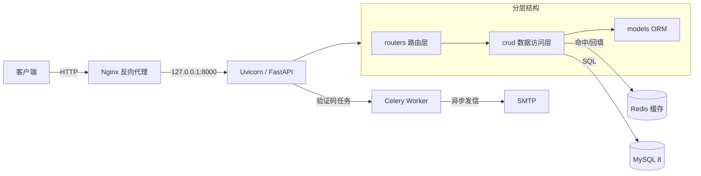

<div align="center">

# 资讯类 App 后端服务

**基于 FastAPI 全异步链路的资讯内容服务平台**

[](https://www.python.org/)
[](https://fastapi.tiangolo.com/)
[](https://docs.sqlalchemy.org/en/20/)
[](https://www.mysql.com/)
[](https://redis.io/)
[](#测试)

21 个 REST 接口 · 6 张业务表 · 全链路 `async/await` · JWT 双令牌 · Redis 多级缓存策略

</div>

---

## 项目简介

面向资讯类移动应用的后端服务，提供**用户认证、资讯分类/列表/详情、收藏、浏览历史**四类核心能力。项目从数据建模、接口设计、缓存策略、数据库迁移到部署配置全流程独立完成，重点实践了以下工程问题：

- 高频读场景下 **Redis 缓存与 MySQL 的一致性设计**
- 高频写场景下 **浏览量的低写放大方案**（Redis ZSET 累计 + 定时批量回写）
- **JWT 双令牌体系**与登录态服务端吊销
- 异步 ORM 与 **Alembic 异步迁移**的接入与踩坑

## 技术亮点

### 1. 全链路异步，无同步阻塞

路由层 → CRUD 层 → `aiomysql` / `redis.asyncio` 全部 `async/await`，单进程即可承载高并发 I/O。

### 2. 按变更频率分级的缓存策略

| 数据 | 策略 | 说明 |
|---|---|---|
| 分类列表 | 整体缓存，TTL 7200s | 变更频率低，整体读写 |
| 新闻分页列表 | 按 `分类:页码:每页大小` 维度缓存 | 页级失效，互不影响 |
| 新闻详情 | 常规 TTL 7200s | 未命中回源后回填 |
| **不存在的新闻** | 占位缓存，TTL 600s | **防缓存穿透**：空值短过期，避免恶意 ID 打穿数据库 |

缓存读取失败自动降级查库，不阻塞接口可用性。

### 3. 浏览量：读走 Redis，写批量落库

详情页浏览量不直接 `UPDATE` 数据库，而是写入 Redis ZSET 累计，后台任务**每 60 秒批量回写一次**（幂等，只更新有变化的行）。将 N 次单行 UPDATE 合并为 1 次批量更新，显著降低热点新闻的写放大。

### 4. JWT 双令牌 + 服务端会话吊销

- `access_token`（30 分钟）+ `refresh_token`（7 天），refresh 令牌入库（`user_token` 表），**改密/登出/注销后可立即吊销**
- 自定义 `HTTPBearer` 子类完成令牌解析与角色校验，refresh 令牌不能当 access 使用
- Redis 会话校验：重新登录后旧 token 立即失效

### 5. 接口安全细节

- 邮箱验证码错误次数落 Redis 计数，超限返回 429 并**锁定 10 分钟**，防止暴力破解
- 数据库层 `UniqueConstraint(user_id, news_id)` 保证收藏幂等——该唯一约束同时兼作 `user_id` 的最左前缀索引，仅为 `news_id` 单独建索引满足外键要求，**省去一个冗余索引**

### 6. 分层异常拦截

`HTTPException`（业务）→ `IntegrityError`（完整性约束）→ `SQLAlchemyError`（数据库）→ `Exception`（兜底）四层注册，全站统一 `{code, message, data}` 信封响应。

## 技术栈

| 类别 | 选型 |
|---|---|
| Web 框架 | FastAPI |
| ASGI 服务器 | Uvicorn |
| ORM | SQLAlchemy 2.0（`Mapped` / `mapped_column` 声明式风格，全异步） |
| 数据库 | MySQL 8.x（驱动 `aiomysql`） |
| 缓存 | Redis（客户端 `redis.asyncio`，RESP2 协议兼容 5.x） |
| 数据校验 | Pydantic v2（`Field(alias=)` 统一 camelCase 契约） |
| 迁移 | Alembic（`async_engine_from_config` 异步引擎） |
| 异步任务 | Celery（邮箱验证码发送） |
| 密码哈希 | passlib + bcrypt |
| Python | 3.12 |

## 架构



## 项目结构

```
toutiao_backend/
├── main.py                 # 应用入口：注册全局异常、CORS 中间件、挂载路由
├── test_api.py             # pytest 测试套件（23 个用例，不依赖真实 MySQL/Redis）
├── alembic.ini             # Alembic 配置
├── myalembic/              # 迁移脚本目录（versions/ 必须随仓库提交）
├── configs/
│   ├── db_config.py        # 异步数据库引擎、会话工厂、get_db 依赖
│   └── cache_conf.py       # Redis 客户端与缓存读写封装（含 JSON 序列化）
├── celerys/                # Celery 异步任务（邮件验证码）
├── models/                 # ORM 模型（news / users / favorite / history）
├── schemas/                # Pydantic 请求 / 响应模型（camelCase 别名契约）
├── crud/                   # 数据访问层（含缓存回源逻辑）
├── routers/                # 路由层（user / news / favorite / history 四组）
├── cache/
│   └── news_cache.py       # 缓存键设计与读写封装
└── utils/
    ├── auth.py             # 当前用户依赖（Bearer Token 解析 + 角色校验）
    ├── security.py         # JWT 签发/解码、bcrypt 密码哈希
    ├── response.py         # 统一成功响应
    ├── exception.py        # 异常处理器实现
    └── exception_handlers.py  # 异常处理器注册
```

分层约定：`routers → crud → models`；`schemas` 作为接口契约，`utils` 提供横切能力。

## 快速开始

### 1. 环境要求

- Python 3.12+
- MySQL 8.x
- Redis 5.x 及以上

### 2. 安装依赖

```bash
pip install -r requirements.txt
```

> 注意：`sqlalchemy` 异步模式需要 `greenlet`，通常随 SQLAlchemy 一起装上；若报缺失请显式安装。
> `bcrypt` 请锁定 `<5`：5.x 移除了 72 字节自动截断，会与 passlib 冲突。

### 3. 配置环境

复制 `.env.example` 为 `.env`，填入你的真实值：

```bash
cp .env.example .env
```

所有连接串与口令（MySQL / Redis / Celery / SMTP / JWT 密钥）都从 `.env` 读取（`pydantic-settings`），代码与仓库中不含任何明文凭据。注意两个细节：

- 密码含 `@` 等特殊字符时，在 `DATABASE_URL` / `BROKER` / `BACKEND` 里要 URL 编码（`@` → `%40`）；Redis 客户端的 `REDIS_PASSWORD` 写原值即可。
- `JWT_SECRET_KEY` 建议 ≥ 32 字节随机串（`python -c "import secrets;print(secrets.token_urlsafe(48))"`）。

### 4. 初始化数据表

表结构由 Alembic 管理：

```bash
# 生成迁移脚本（模型与库有差异时）
alembic revision --autogenerate -m "your message"

# 执行迁移建表
alembic upgrade head

# 校验模型与库是否一致
alembic check
```

同时需准备基础数据：至少插入若干条 `news_category` 与 `news` 记录。

### 5. 启动服务

```bash
uvicorn main:app --host 0.0.0.0 --port 8000
```

启动后访问：

- 交互式接口文档（Swagger UI）：<http://127.0.0.1:8000/docs>
- OpenAPI 描述文件：<http://127.0.0.1:8000/openapi.json>

## 测试

测试套件位于根目录 `test_api.py`，共 **23 个用例**，按模块分为 6 组：

| 分组 | 覆盖内容 |
|---|---|
| `TestRouteRegistration` | 21 个业务接口 + 根路由全部挂载，路由数量守卫 |
| `TestParamValidation` | 列表接口非法分页参数返回 422 |
| `TestJwtUtils` | JWT 签发/解码、refresh 令牌有效期、过期与伪造的区分、bcrypt 密码校验 |
| `TestAuthLogic` | access/refresh 令牌类型与用户角色的校验规则 |
| `TestCacheKeys` | 缓存键拼装格式、缓存穿透占位缓存的 600s 短 TTL |
| `TestNewsApi` | 列表/详情接口编排逻辑：缓存命中不触库、Redis 浏览量覆盖、`hasMore` 边界、404 信封、camelCase 契约 |

```bash
pytest test_api.py -v
```

- **不需要真实的 MySQL / Redis / RabbitMQ / SMTP**——外部依赖全部 mock，可在任何机器直接运行
- 唯一前提是项目根目录存在 `.env`，缺失时整套用例自动跳过并给出提示
- 运行依赖 `pytest`、`httpx`：`pip install pytest httpx`

## 接口说明

统一前缀 `/api`，需要登录的接口通过请求头传递令牌：

```
Authorization: Bearer <token>
```

### 接口清单

| 模块 | 方法 | 路径 | 说明 | 需要登录 |
|---|---|---|---|---|
| 资讯 | GET | `/api/news/categories` | 获取新闻分类 | 否 |
| 资讯 | GET | `/api/news/list` | 按分类分页获取新闻 | 否 |
| 资讯 | GET | `/api/news/detail` | 新闻详情（浏览量 +1，含同类推荐） | 否 |
| 用户 | POST | `/api/user/register` | 注册（返回 token 与用户信息） | 否 |
| 用户 | POST | `/api/user/varify_email` | 校验邮箱验证码（恢复已注销账号） | 否 |
| 用户 | POST | `/api/user/login` | 登录 | 否 |
| 用户 | POST | `/api/user/refresh` | 刷新令牌 | 否 |
| 用户 | GET | `/api/user/info` | 获取当前用户信息 | 是 |
| 用户 | PUT | `/api/user/update` | 修改昵称/头像/性别/简介/手机号 | 是 |
| 用户 | PUT | `/api/user/password` | 修改密码（校验旧密码） | 是 |
| 用户 | DELETE | `/api/user/logout` | 登出 | 是 |
| 用户 | DELETE | `/api/user/cancel` | 注销账号 | 是 |
| 收藏 | GET | `/api/favorite/check` | 查询某新闻是否已收藏 | 是 |
| 收藏 | POST | `/api/favorite/add` | 添加收藏 | 是 |
| 收藏 | DELETE | `/api/favorite/remove` | 取消收藏 | 是 |
| 收藏 | GET | `/api/favorite/list` | 收藏分页列表 | 是 |
| 收藏 | DELETE | `/api/favorite/clear` | 清空收藏 | 是 |
| 历史 | POST | `/api/history/add` | 添加浏览记录 | 是 |
| 历史 | GET | `/api/history/list` | 浏览历史分页列表 | 是 |
| 历史 | DELETE | `/api/history/delete/{history_id}` | 删除单条浏览记录 | 是 |
| 历史 | DELETE | `/api/history/clear` | 清空浏览历史 | 是 |
| 根 | GET | `/` | 健康检查 | 否 |

完整参数说明见 Swagger 文档（`/docs`）。

### 响应格式

成功与异常响应统一信封，`code` 与 HTTP 状态码一致：

```json
{ "code": 200, "message": "success", "data": null }
```

| 场景 | HTTP | 说明 |
|---|---|---|
| 业务异常 | 400 / 401 / 403 / 404 / 429 | 由路由主动抛出 `HTTPException` |
| 数据完整性约束冲突 | 400 | 如用户名已存在、关联数据不存在 |
| 数据库异常 / 未捕获异常 | 500 | 兜底处理器接管 |

> 当前 Pydantic 参数校验失败仍返回 FastAPI 默认的 `{"detail": [...]}`，未套用信封，见 Roadmap。

## 数据库设计

共 6 张表：

| 表名 | 说明 | 关键约束 / 索引 |
|---|---|---|
| `news_category` | 新闻分类 | `name` 唯一 |
| `news` | 新闻 | 索引 `fk_news_category_idx(category_id)`、`idx_publish_time(publish_time)` |
| `user` | 用户 | `username`、`email`、`phone` 唯一 |
| `user_token` | 登录令牌 | `user_id` 唯一（一对一）；`access_token`、`refresh_token` 唯一 |
| `favorite` | 收藏 | 唯一约束 `user_news_unique(user_id, news_id)` 兼作最左前缀；`idx_news_id` 满足外键要求 |
| `history` | 浏览历史 | 索引 `fk_history_user_idx`、`fk_history_news_idx`、`idx_view_time` |

## 缓存设计

| 用途 | Key 格式 | TTL |
|---|---|---|
| 新闻分类 | `news:categoties` | 7200 s |
| 新闻分页列表 | `news_list:{categoryId}:{page}:{pageSize}` | 7200 s |
| 新闻详情 | `news:details:{newsId}` | 7200 s |
| 不存在的新闻（防穿透） | `news:details:{newsId}`（error 占位） | **600 s** |
| 浏览量累计 | `news:views:`（ZSET） | 不过期，60s 批量落库 |

- 缓存读取失败时自动降级查库，不影响接口可用性
- 缓存对象统一 JSON 存储（`ensure_ascii=False` 保留中文）
- Key 拼装集中在 `cache/news_cache.py`，便于统一维护

## 部署

生产部署链路：**CentOS + Nginx 反向代理 + systemd 守护**

```
客户端 → Nginx(:80/443) → proxy_pass → uvicorn(127.0.0.1:8000)
```

- uvicorn 以 systemd service 常驻（`Restart=always`）
- Nginx 只暴露 80/443，应用端口不对外
- SELinux 需开启 `httpd_can_network_connect`，HTTPS 用 certbot 签发

## Roadmap

- [x] pytest + httpx 接口测试（23 用例全绿）
- [ ] 统一 `RequestValidationError` 的响应信封
- [ ] 提供 Dockerfile 与 docker-compose（应用 + MySQL + Redis 一键启动）
- [ ] 为列表接口补充压测数据与缓存命中率统计
- [ ] 令牌续期与改密后吊销全部会话（部分已实现：refresh 入库可吊销）

## 说明

本项目为独立完成的实践项目，用于系统性地实践 FastAPI 异步后端的分层设计、缓存策略、鉴权体系与数据库迁移等核心能力。代码中不含任何真实凭据，敏感配置全部走 `.env`。
